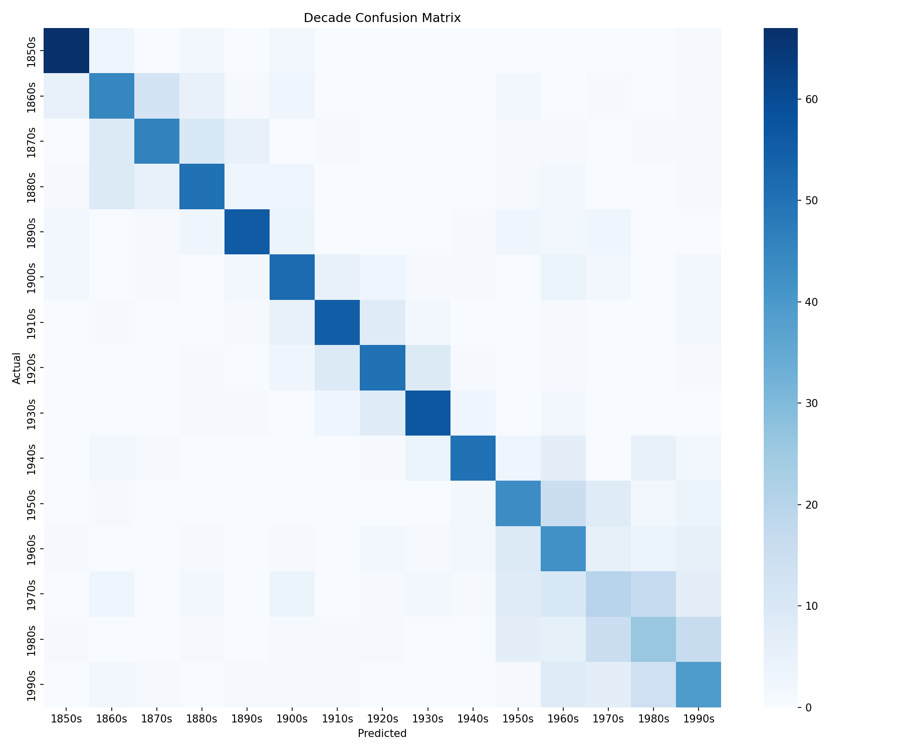
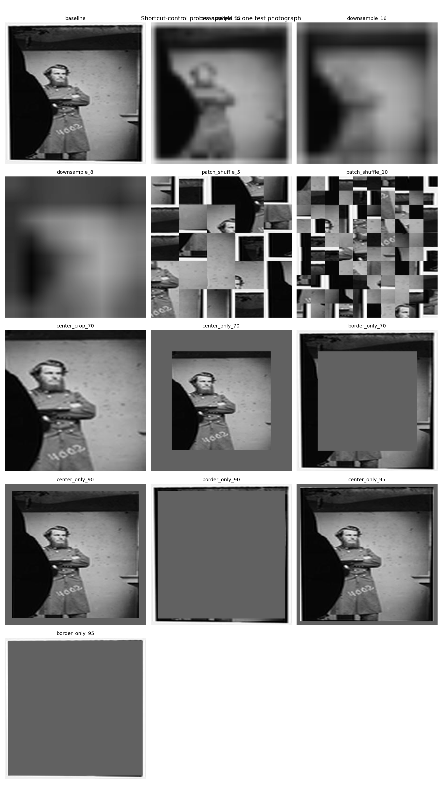
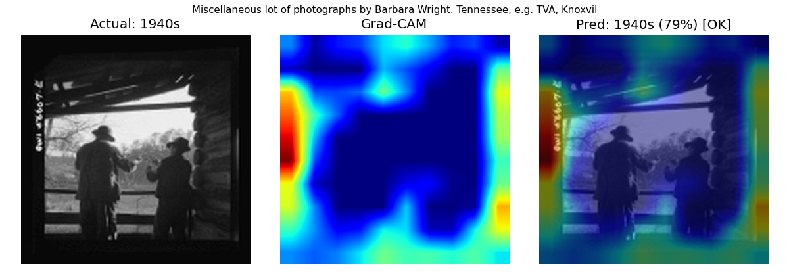

## Photo Dater

# Can a model date a photograph?

Training a CNN to predict the decade a photo was taken — purely from visual features — then running controlled experiments to find out whether it learned historically meaningful signals or just digitization artifacts.

**Headline result: 63.0% ± 1.3% accuracy across 15 decades** (chance is 6.7%), with a mean error of 9.4 years, measured on a held-out test split across 5 training seeds.

---

## The question

Photographs carry visual signatures of their era: film grain, lighting ratios, composition conventions, clothing, and technology in the frame. This project asks whether a neural network can recover those signals well enough to assign a decade to an unseen photo — and more importantly, *what* it's actually looking at when it does.

The second half of that question turns out to be the harder and more interesting one. A model can reach respectable accuracy by reading scan tone or border styling that happens to correlate with when an archive digitized a collection, and no amount of staring at Grad-CAM heatmaps will tell you whether that's happening. [Shortcut controls](#did-it-actually-learn-history) below test it directly.

## Results

| Metric | Value |
|---|---|
| Test accuracy | **63.0% ± 1.3%** (chance: 6.7%) |
| Mean decade error | **9.4 ± 0.5 years** |
| Hardest confusions | 1970s ↔ 1980s |
| Test set | 1,125 images, never used for training or model selection |
| Runs | 5 seeds, identical data split |

Per-seed test accuracy: 62.0, 62.7, 64.6, 64.2, 61.6.



### Per-decade F1 (mean across 5 seeds)

| Decade | F1 | | Decade | F1 | | Decade | F1 |
|---|---|---|---|---|---|---|---|
| 1850s | **0.86** | | 1900s | 0.68 | | 1950s | 0.62 |
| 1860s | 0.64 | | 1910s | 0.73 | | 1960s | 0.51 |
| 1870s | 0.67 | | 1920s | 0.67 | | 1970s | **0.34** |
| 1880s | 0.64 | | 1930s | 0.75 | | 1980s | **0.36** |
| 1890s | 0.75 | | 1940s | 0.71 | | 1990s | 0.52 |

Performance declines steadily from the oldest decades to the 1970s–80s, then recovers slightly. Early photographic processes carry distinctive signatures — mounts, studio poses, albumen tonality — while late-century photography converted to grayscale looks much alike across adjacent decades. Nearly all errors are off-by-one-decade, which is why mean decade error stays under 10 years despite 37% of predictions being wrong.

## Did it actually learn history?

Grad-CAM shows where gradient flows, not what the model would fail without. To test that, [`src/shortcut_control.py`](src/shortcut_control.py) destroys one kind of information at a time and re-scores the test set. The useful number is **retained signal** — the share of above-chance accuracy that survives, `(probe − chance) / (baseline − chance)`.



| Hypothesis | Probe | Accuracy | Retained |
|---|---|---|---|
| — | baseline | 0.630 ± 0.013 | 100% |
| Model reads global scan tone | downsample to 8×8 | 0.071 ± 0.005 | **1%** |
| Model reads film grain / JPEG texture | shuffle 100 tiles | 0.106 ± 0.016 | **7%** |
| Model reads borders, mounts, vignetting | outer 10% ring only | 0.075 ± 0.013 | **2%** |
| Borders are dispensable | outer frame removed | 0.569 ± 0.007 | 89% |

**All three shortcut hypotheses fail.** Downsample a photo to 8×8 and the model sits at chance — so it isn't riding overall brightness or exposure. Shuffle it into 100 scrambled tiles and it collapses too — so it isn't riding film grain or scan texture either. Hand it only the outermost 10% of the frame, where mounts and vignetting live, and it retains 2% of its signal.

The border sweep is the cleanest evidence. As the surviving ring narrows from 51% to 19% to 10% of the image area, retained signal decays monotonically: 47% → 9% → 2%. That is the signature of photographic content leaving the frame, not of a border artifact. Conversely, strip only the outer frame and keep everything else, and 89% of the signal survives.

So the model needs fine detail **and** global composition simultaneously, and depends on neither the frame nor the overall tone. That is what reading photographic content looks like.

Full numbers: [`results/shortcut_control.json`](results/shortcut_control.json).

### Grad-CAM



Heatmaps in [`results/gradcam/`](results/gradcam) — regenerate with `python src/gradcam.py`. Consistent with the controls above, attention falls on subject matter rather than borders or scan noise. Adjacent-decade confusions typically show similar compositions where era-specific cues are genuinely subtle.

## Methodology

**Three-way split, reported once.** Earlier versions of this project selected the best checkpoint by maximum validation accuracy and then reported that same validation number — which inflates the result, because the winner is the luckiest of ~20 noisy measurements rather than the best model. Data is now split 70/15/15 stratified by decade: train produces gradient updates, val picks the epoch, and test is scored exactly once.

The empirical case for bothering: across 5 seeds, **validation ranking barely predicts test ranking.** Seed 3 had the *worst* val accuracy and the *best* test accuracy. Picking a model on validation and publishing that same number is measuring your own luck.

**Split seed is pinned independently of the training seed** ([`src/dataset.py`](src/dataset.py)). If the split moved with `--seed`, a multi-seed comparison would score each run on photos the other runs had trained on.

**Variance is reported, not hidden.** A single accuracy figure on 1,125 images carries ±1.4 points of standard error, so two runs differing by a point are indistinguishable. Five seeds give ±1.3 points of spread — about what sampling noise alone predicts, which is itself evidence the training process is stable.

## Pipeline

```
LOC API → raw images → preprocessing → EfficientNet fine-tuning
        → evaluation → shortcut controls → Grad-CAM → Gradio demo
```

| Stage | Details |
|---|---|
| Data | 7,500 dated photographs from the Library of Congress, 500 per decade, 1850s–1990s |
| Preprocessing | Grayscale, resized 300×300 |
| Model | EfficientNet-B3 pretrained on ImageNet; stem adapted to 1 channel; 2-stage fine-tune |
| Training | 5 epochs head-only, then 15 epochs with the last 3 blocks unfrozen |
| Evaluation | Per-decade F1, confusion matrix, mean decade error, seed aggregation |
| Interpretability | Grad-CAM heatmaps plus quantitative shortcut controls |
| Demo | Gradio app: upload a photo, get a predicted decade + heatmap |

Training takes ~11 minutes per run on an RTX 2070 Super.

## Repository structure

```
photo-dater/
├── data/
│   ├── raw/                  # Downloaded LOC images, by decade
│   └── processed/            # Grayscale, resized 300×300
├── src/
│   ├── scraper.py            # Library of Congress API ingestion
│   ├── preprocess.py         # Cleaning, grayscale conversion, resizing
│   ├── dataset.py            # Dataset, weighted sampler, 70/15/15 split
│   ├── train.py              # Two-stage fine-tuning
│   ├── evaluate.py           # Metrics, confusion matrix, per-split scoring
│   ├── aggregate_seeds.py    # Mean ± std across seeds
│   ├── shortcut_control.py   # Occlusion / downsample / shuffle probes
│   └── gradcam.py            # Grad-CAM implementation
├── tests/                    # Split integrity, dedup, probe geometry
├── results/                  # Metrics, figures, heatmaps (tracked)
├── app.py                    # Gradio demo
├── requirements.txt
├── LICENSE
└── README.md
```

## Quickstart

```bash
git clone https://github.com/jwei11/photo-dater.git
cd photo-dater
python -m venv photo-dating-env
source photo-dating-env/bin/activate   # Windows: photo-dating-env\Scripts\activate
pip install -r requirements.txt

python src/scraper.py        # Collect data (~7,500 images)
python src/preprocess.py     # Grayscale + resize
python src/train.py          # Fine-tune (~11 min on a 2070 Super)

python src/evaluate.py --split test   # Report metrics
python src/shortcut_control.py        # Run the shortcut controls
python src/gradcam.py                 # Sample heatmaps
python app.py                         # Launch the demo
```

Reproduce the 5-seed result:

```bash
for s in 1 2 3 4 5; do python src/train.py --seed $s --checkpoint-name best_seed$s.pt; done
for s in 1 2 3 4 5; do python src/evaluate.py --split test --checkpoint checkpoints/best_seed$s.pt --tag seed$s; done
python src/aggregate_seeds.py --split test
```

## Key design decisions

**Grayscale conversion** — all images are converted to grayscale before training. Without this, the model would learn "color photo = recent" as a trivial shortcut, bypassing the visual features we actually care about. The shortcut controls above exist to check that closing this door didn't just push the model toward a subtler one.

**Decade classification over regression** — framing this as 15-class classification rather than year regression makes evaluation cleaner and confusion matrices interpretable. Mean decade error is reported as a secondary metric and captures the off-by-one structure of the errors.

**Transfer learning over training from scratch** — 7,500 images would primarily teach a model to overfit. EfficientNet's pretrained low-level features transfer directly to the textures and edges that encode era. The engineering that matters here is what gets fine-tuned, how decades are balanced, and how the result is validated.

**Weighted sampling** — pre-1900 photographs are underrepresented in the LOC collection, so training uses a weighted sampler to prevent the model from simply predicting mid-century for everything.

## Limitations

**The model overfits heavily.** Training accuracy reaches 99.5% while validation plateaus near 62%. The generalization gap is the single largest opportunity for improvement, and more aggressive augmentation or regularization is the obvious next step.

**Adjacent modern decades are barely separable.** 1970s and 1980s sit at F1 0.34 and 0.36. In grayscale, a 1978 snapshot and a 1983 snapshot often carry no distinguishing cue a human could name either.

**One archive, one country.** Everything comes from the Library of Congress, so the model has learned what American photographs in one institution's collection look like by decade. Geographic and institutional bias is unmeasured.

**Probe design is not free of artifacts.** The occlusion controls introduce a masked region that is itself out of distribution. An earlier version using flat mid-gray fill produced 8–9× the seed variance of every other probe; switching to per-image mean fill resolved it. The thin-ring results are stable (±0.007–0.013), but occlusion remains the least clean instrument here.

## What's next

- **Cloud training** — the current pipeline runs locally. Moving to an EC2 `g4dn.xlarge` spot instance with checkpoints in S3 would make multi-seed sweeps and hyperparameter search practical beyond one GPU.
- Add Europeana and NYPL as data sources to improve pre-1900 coverage and reduce single-archive bias
- Attack the overfitting gap: stronger augmentation, mixup, longer head-only warmup
- Audit errors for systematic bias toward particular geographic regions or collections
- Test a regression formulation to see whether predicting year directly beats decade classification on mean error

## License

MIT — see [LICENSE](LICENSE)
